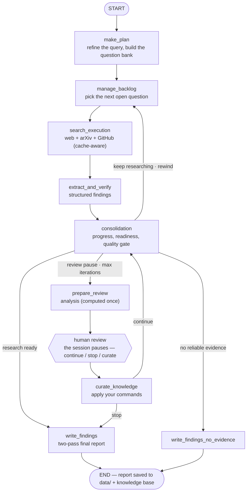

# Research Agent

An autonomous research agent that turns a question into a cited report.

It plans a question bank, searches the web (Exa / Brave / ArXiv / GitHub),
extracts structured findings, and curates them into a persistent knowledge
base — with you in the loop: the session pauses for your review at regular
intervals and can be resumed after any interruption. Every step of the
pipeline can run on a different LLM model, even a different provider.

**What you get:** a Markdown report with sources (a timestamped file in
`data/`, readable any time with `python run.py report`), a browsable
knowledge base of findings, and a resumable session.

## Quick start

Requires Python 3.10+.

```bash
cd research_agent
python3 -m venv venv && source venv/bin/activate
pip install -r requirements.txt

# Configure: pick a provider, add your keys
cp .env.example .env
$EDITOR .env
```

You need:

- **One LLM** — a local model (llama.cpp / Ollama) and/or an OpenAI or
  Anthropic API key
- **One search key** — Exa and/or Brave. (ArXiv and GitHub search work
  without keys, just rate-limited.)

Then run your first session:

```bash
python run.py ask "The future of micro-frontends in 2026"
```

`python run.py` with no arguments opens the interactive menu instead.
API keys and workflow settings come from `.env` or environment variables —
nothing is hardcoded. (`playwright` is only used if you set
`BROWSER_SEARCH_ENABLED=true`.)

Useful flags on `ask`:

```bash
python run.py ask "your query" --provider openai            # override the provider
python run.py ask "your query" --model gpt-4o               # override the model
python run.py ask "your query" --max-iterations 15          # change the loop budget
python run.py ask "your query" --plan-id plan_abc123        # continue an existing plan
```

## What happens when you ask

1. **Effective-config banner** — the exact model per step and search
   settings that will run, so you never have to guess from `.env`:

   ```
   ── Effective config ────────────────────────────────────────────
       model:      local/qwen38_27 (all steps, except:)
       report:     anthropic/claude-sonnet-5-5
       search:     primary=exa  arxiv=auto  github=auto  citations=on  cache=30d
   ```

2. **The research loop** — one question per iteration: search (routed per
   question across web / arXiv / GitHub), extraction into structured
   findings, and a progress check. `[LLM] <step> (<model>): …` log lines
   show which model is working (see [Reading the session log](#reading-the-session-log)).

3. **Review pauses** — every `REVIEW_EVERY` iterations (default 5), the
   session suspends and shows an interim analysis, the open questions,
   curation recommendations, and the raw entries. Type `1` or `continue`
   to keep going, `2` or `stop` to finish and write the report. Full
   command set below.

4. **The report** — a two-pass synthesis, saved as a timestamped Markdown
   file in `data/` and in the knowledge base. Read it any time with
   `python run.py report`.

The session ends when the readiness check says the research is done *and*
the question bank is sufficiently resolved, when the iteration budget
(`MAX_ITERATIONS`, default 10) runs out, or when you type `stop` at a
review. If readiness passes but the question bank isn't resolved enough,
you get a review screen (interim report) instead of a silent stop.

### Review commands

Type a number, a full command, or `?` for help:

| Shortcut | Command | Effect |
|---|---|---|
| `1` / blank line | `continue` | Skip curation, continue research |
| `2` | `stop` | End research and write the final report |
| `3` | `stats` | Full knowledge-base stats |
| `4` | `findings` | Show all extracted findings (including discarded) |
| `5` | `contradictions` | Show all flagged contradiction pairs |
| `6` | `rewind` | Force one more backlog-pass cycle before the next review |
| `?` / `help` | — | Re-print the command menu |
| — | `curate <id>` | Promote a raw entry to the curated library |
| — | `discard <id>` | Remove an entry |
| — | `tag <id> <t>` | Add topic tags to an entry |
| — | `retry <id>` | Reset a `failed` question to `pending` (re-process it) |
| — | `accept <id>` | Resolve a `failed` question with a placeholder finding (sources exist, extraction failed) |
| — | `gap <n>` | Add the n-th gap from the interim analysis as a research question |

Full command names work too (case-insensitive), and a typo re-prompts
instead of silently continuing the graph.

## Browsing your research

All browsers exit on `q` (Ctrl-C works too); `r` refreshes.

| Command | What you get |
|---|---|
| `python run.py plans` | All plans with progress; pick one to see its questions and saved reports |
| `python run.py plan <id>` | One plan's questions and reports |
| `python run.py backlog [plan_id]` | Shape the open-question queue without running the graph: `up 3`, `down 2`, `set 2 high`, `add <text>`, `drop 1`, `retry 4` |
| `python run.py results [plan_id]` | Findings (marked valid or discarded) plus knowledge entries; pick one for full detail |
| `python run.py report [plan_id]` | Saved reports, newest first |
| `python run.py stats` | Knowledge-base stats (entries by status, top tags) plus a per-plan summary |
| `python run.py models` | Which model (and provider) runs each step — and change it in place |

## Models per step

Every step of the pipeline can run on a different model — even a different
*provider*. A typical setup: fast/cheap local model for the high-volume
steps, strong cloud model for the report.

**The easy way — `python run.py models`** (also menu item 7). It shows
what each step does, which model it currently runs on, and lets you change
it in place (saved to `.env`, applied to the running config):

```
models> set report anthropic/claude-sonnet-5-5
  ✓ report → anthropic/claude-sonnet-5-5  (saved to .env)
models> unset report        # back to the default
models> env                 # print the exact .env lines
```

**What to pick for which step** (rules of thumb, not requirements):

| Step | What it does | Calls per session | Model guidance |
|---|---|---|---|
| `planning` | turns the query into a question bank | a few | a strong model pays off here |
| `extraction` | parses each search result into structured findings | one per question — highest volume | a fast model is usually fine |
| `curation` | ready-check, dedup, contradiction analysis at reviews | moderate | a fast model is usually fine |
| `report` | writes the final report (two passes, longest output) | 1–2 | this is where a strong model shows most |

**The manual way — `.env`** (same knobs, for scripts/CI):

```env
# Global default — used by any step without an override
PROVIDER=local
LOCAL_MODEL=qwen38_27

# The report runs on a different provider
REPORT_PROVIDER=anthropic
REPORT_MODEL=claude-sonnet-5-5

# (Optional) a different local model for one step
EXTRACTION_MODEL=fast-7b
```

- `*_MODEL` — model name for that step (empty = the step's provider's default model)
- `*_PROVIDER` — provider for that step (empty = the global `PROVIDER`); `local`, `openai`, or `anthropic`
- Available for the steps `PLANNING`, `EXTRACTION`, `CURATION`, `REPORT`

An invalid provider value fails at session start with a named env var,
before any LLM call.

## Resuming a session

Every step is checkpointed to SQLite (`data/checkpoints.db`), so Ctrl-C,
crashes, and reboots are recoverable:

```bash
python run.py resume plan_abc123def4     # by plan ID (shown when the plan is created)
python run.py resume <thread-uuid>       # or by the session ID from the banner
```

A session suspended at a review re-displays the review screen from the
checkpoint; a session that died mid-step continues from its last
checkpoint.

## Configuration

All settings are environment variables (or `.env` in this directory —
`.env.example` documents every knob). The environment wins over `.env`.

| Variable | Default | Description |
|---|---|---|
| `PROVIDER` | `local` | `local`, `openai`, or `anthropic` |
| `LOCAL_MODEL` | `qwen36_35` | Local model name (as served by your llama.cpp/Ollama endpoint) |
| `LOCAL_BASE_URL` | `http://localhost:8080/v1` | Local API endpoint |
| `LOCAL_API_KEY` | `not-needed` | Only if your local server requires one |
| `OPENAI_API_KEY` / `OPENAI_MODEL` | — / `gpt-4o` | OpenAI credentials |
| `ANTHROPIC_API_KEY` / `ANTHROPIC_MODEL` | — / `claude-sonnet-5-5` | Anthropic credentials |
| `ANTHROPIC_BASE_URL` | — | Optional proxy/base URL override |
| `EXA_API_KEY` | — | Exa search API key |
| `BRAVE_API_KEY` | — | Brave Search API key |
| `SEARCH_PRIMARY` | `exa` | Primary search engine: `exa`, `brave`, `arxiv`, or `exa+brave` (both, merged) |
| `SEARCH_FORCE_ARXIV` | `auto` | `auto` (science vocabulary decides), `web`, `arxiv`, or `both` |
| `ARXIV_MAX_RESULTS` | `10` | Max results from the arXiv engine |
| `GITHUB_TOKEN` | — | GitHub token for the repositories leg (30 req/min; keyless = 10 req/min) |
| `GITHUB_MAX_RESULTS` | `5` | Max repos from the GitHub engine |
| `SEARCH_FORCE_GITHUB` | `auto` | `auto` (OSS vocabulary decides), `on` (always), or `off` (never) |
| `ENABLE_CITATION_DISCOVERY` | `true` | Use the Exa answer API to find foundational papers |
| `SEARCH_CACHE_TTL_DAYS` | `30` | Lifetime of cached search results (0 = never expires) |
| `BROWSER_SEARCH_ENABLED` | `false` | Browser-based content enrichment (requires Playwright) |
| `MAX_ITERATIONS` | `10` | Loop budget before interim analysis |
| `REVIEW_EVERY` | `5` | Pause for human review every N iterations |
| `MIN_FINDINGS` | `3` | Minimum valid findings required for the ready check |
| `READY_COVERAGE_GATE` | `true` | Block auto-stop when the coverage floor is unmet |
| `READY_MIN_RESOLUTION` | `0.5` | Minimum fraction of the question bank that must be closed for auto-stop (any open high-priority question blocks regardless) |
| `REFINE_QUERY_THRESHOLD` | `20` | Queries shorter than this (chars) skip LLM refinement |
| `PLANNING_MODEL` / `EXTRACTION_MODEL` / `CURATION_MODEL` / `REPORT_MODEL` | *(step's provider default)* | Per-step model overrides — see [Models per step](#models-per-step) |
| `PLANNING_PROVIDER` / `EXTRACTION_PROVIDER` / `CURATION_PROVIDER` / `REPORT_PROVIDER` | *(global `PROVIDER`)* | Per-step provider overrides (cross-provider steps) |
| `RESEARCH_BASE_DIR` | `research_agent/data` | Data directory (DB, checkpoints, report files) |

## Reading the session log

| Line | Meaning |
|---|---|
| `Iteration N` | Loop anchor — one question per iteration |
| `[ROUTING] q → web=… arxiv=… github=… (reason)` | Per-question search routing; the reason explains the decision (science vocabulary / OSS vocabulary) |
| `[GITHUB] N repos for: '…'` | The GitHub repositories leg ran on a compact phrase derived from the question |
| `[CITATION DISCOVERY] …` | Exa answer API fetched foundational papers |
| `[LLM] <step> (<model>): generating… / done` | Which step and which model is being called (per-step overrides show up here) |
| `[REPORT] Pass 1 … / Pass 2 …` | The final report is two-pass: pass 1 synthesizes from a prioritized subset of findings, pass 2 merges in the rest |
| `Report passes: N` (inside the report) | `2` = full two-pass, `1` = short plan (one pass sufficed), `0` = deterministic fallback |

The session ends with a cost summary; when several models were used it
breaks calls, tokens, and $ out per model.

## How it works



Each iteration picks the highest-priority open question, searches for it
(cache-aware), extracts structured findings, and consolidates progress.
If the research is ready but the question bank isn't fully resolved, the
session goes to a human review (interim report) instead of stopping
silently — `stop` there writes the report anyway.
Notable behaviors:

- **Multi-engine search, routed per question** — Exa/Brave web search,
  arXiv for science-flavored questions, GitHub repositories for
  open-source-flavored questions (searched as a compact phrase — the
  GitHub API ANDs every keyword, so a full question matches nothing), and
  citation discovery for foundational papers.
- **Source diversity cap** — 3 results per domain, so one popular site
  can't dominate; `github.com`, `arxiv.org`, and academic publishers are
  exempt since every URL there is a distinct primary source.
- **Quality filter** — generic filler findings are discarded and tracked.
- **Scope guards** — every plan stores a scope block derived from its own
  query, so off-topic filtering is topic-specific rather than hard-coded.
- **Failure recovery** — extraction errors mark questions `failed`
  (non-terminal); `retry <id>` re-processes them, `accept <id>` resolves
  them with a placeholder finding that records the gap.
- **Pre-flight plan matching** — before creating a new plan, the agent
  warns if a similar active plan already exists (use `--plan-id` to
  continue one instead).
- **Self-correction** — coverage gaps from the readiness check are
  promoted back into the question bank, so the loop addresses them
  instead of spinning.

## Knowledge base

SQLite at `data/knowledge.db`:

| Table | Contents |
|---|---|
| `plans` | One row per research session; `thread_id` links to its checkpoint thread (enables resume) |
| `questions` | The question bank; `status`: `pending` → `in_progress` → `resolved` / `failed` / `discarded` |
| `search_cache` | Cached search results, keyed by query + engine + arXiv/GitHub flags |
| `raw_results` | Raw search hits per question (with engine labels) |
| `knowledge_entries` | The curated library: `raw` → `curated` / `discarded`, with tags, summary, full text |
| `curated_findings` | Structured findings per question (facts with confidence, summary, tags) |
| `reports` | Final reports (also written to timestamped `.md` files in `data/`) |

Pre-existing databases are migrated in place on startup.

## For developers

```
research_agent/
├── config/
│   ├── settings.py            # LLM, search, paths, workflow settings (env-wired)
│   └── prompts.py             # LLM prompt templates
├── state/research_state.py    # LangGraph state definition
├── db/
│   ├── engine.py              # SQLite connection, schema, migrations
│   └── knowledge.py           # CRUD operations (plan-scoped)
├── cache/search_cache.py      # Search query cache
├── nodes/
│   ├── planning.py            # Query refinement + plan creation
│   ├── backlog.py             # Question selection + re-prioritization
│   ├── search.py              # Cache-aware multi-engine search
│   ├── arxiv_search.py        # arXiv engine leg
│   ├── browser_search.py      # Optional Playwright enrichment
│   ├── extraction.py          # Fact extraction + follow-up questions
│   ├── consolidation.py       # Progress assessment + DoD check + routing
│   └── curation.py            # Review analysis + interrupt + curation commands
├── utils/
│   ├── cost.py                # Per-model cost tracking
│   ├── citations.py           # Citation validation + references-section rebuild
│   ├── llm.py                 # Shared JSON extraction/parsing for LLM output
│   ├── quality.py             # Finding quality filter
│   ├── scope.py               # Deterministic scope block (query → DISCARD-rule anchor)
│   ├── search_routing.py      # Per-question engine routing (science/OSS vocabulary)
│   └── env_file.py            # .env upsert (used by the models browser)
├── ui/
│   ├── theme.py               # ANSI colors/boxes/badges (auto-off when not a TTY)
│   ├── review.py              # Review screen + numbered command parsing
│   └── views.py               # Plans/backlog/results/reports/stats/models browsers
├── graph/workflow.py          # LangGraph StateGraph assembly + build_app()
├── docs/search.md             # Search routing deep-dive
├── tests/                     # See below
└── run.py                     # CLI (interactive menu, subcommands, legacy forms)
```

### Tests

```bash
python -m pytest tests/ -q --ignore=tests/test_search_integration.py
```

The suite is hermetic: LLM calls use scripted mocks dispatched on prompt
content, search calls are patched, and all data lands in a throwaway test
DB. It covers the DB layer, every node, the interrupt/resume cycle
end-to-end, the CLI (dispatch, review-screen parsing, browsers, and full
sessions driven through `main()`), per-step model resolution, and the
`.env` upsert. `tests/test_search_integration.py` is the one exception —
it exercises the live Exa/ArXiv APIs, so it is excluded from the default
run.

### Pre-commit

`.pre-commit-config.yaml` runs ruff (lint + format) and the test suite on
every commit. Install with `pre-commit install` (the hooks use the
`python` on your PATH, so activate your venv first).

## Legacy CLI forms

The older invocations still work:

```bash
python run.py "your query" --provider openai --model gpt-4o
python run.py --resume plan_abc123def4
python run.py --plan-id plan_abc123def4 "your query"
```
